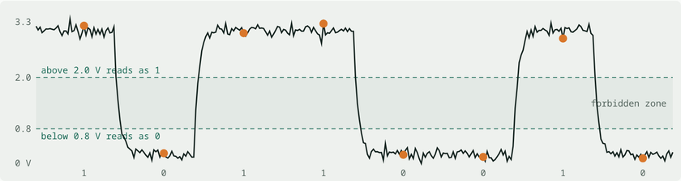
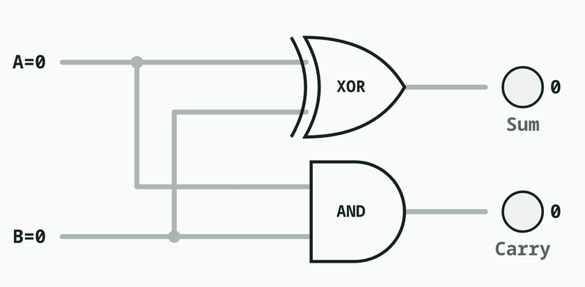
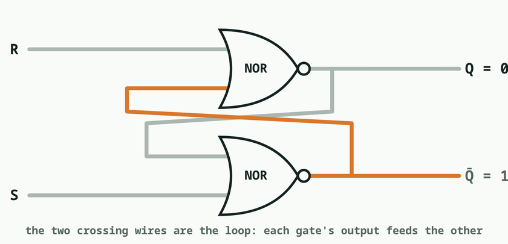
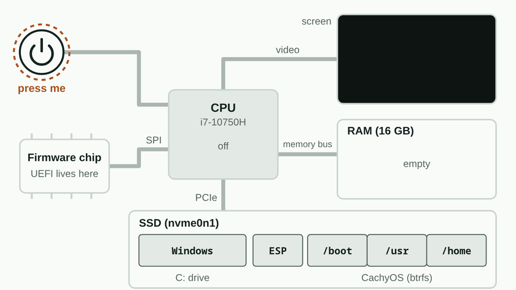
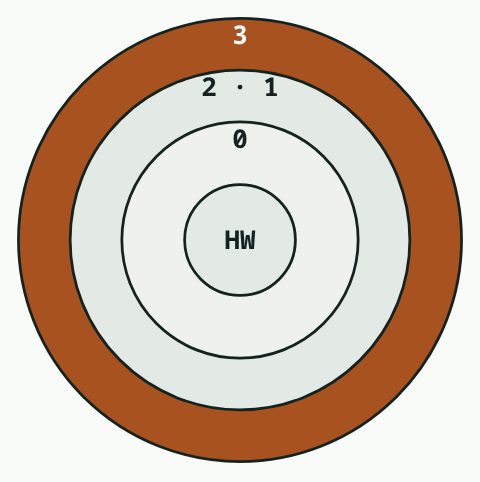

I studied **mechatronics engineering**, so I'd studied most of these pieces before: digital electronics, how transistors and logic gates build a processor, memory, processors, etc. But each one came in a different course, in a different semester, and sometimes it's a bit hard to connect all the contents, to have the whole picture.

So when I started using Linux every day, I wanted to understand everything end to end: **from the voltage in a transistor to my laptop running Linux**, each layer built on the one below.

| # | Layer | The idea in one line |
|---|---|---|
| 1 | Bits and signals | A bit is a voltage: clearly high is 1, clearly low is 0 |
| 2 | Transistors and gates | A switch flipped by electricity, wired into logic |
| 3 | Memory | A loop that holds itself in place remembers |
| 4 | The CPU | Fetch, decode, execute, repeat, forever |
| 5 | Firmware and boot | Copy the next program into RAM, jump to it |
| 6 | The operating system | One program owns the hardware and shares it fairly |

Each layer hides the details of the one below, so you can think about one level at a time. That's **abstraction**, and it's behind everything in computing.

## 1️⃣ Bits and signals

Voltage on a wire is analog and noisy. Chips use **thresholds**: above one line is 1, below another is 0. With only two levels far apart, a copy of a copy is still perfect. That's why computers are digital.

*A noisy signal still reads cleanly: above the upper line is 1, below the lower line is 0.*

The same byte `01000001` is the number 65, the letter `A` or a shade of grey. **The bits never change; the program reading them decides what they mean.**

## 2️⃣ Transistors and logic gates

A transistor is a switch flipped by electricity, so one can flip the next. Two in a row make **AND**, two side by side make **OR**.

My favourite part: adding two bits. The sum is **XOR** and the carry is **AND**. Chain 64 of those and you have the adder in my CPU. The gates don't understand addition; electricity just can't flow any other way.

*A half adder: XOR gives the sum, AND gives the carry.*

## 3️⃣ Memory

Gates forget as soon as the input changes. Feed the output back into the input and the loop holds itself: a stored bit.

*Two NOR gates feeding each other: the loop that remembers one bit.*

| Memory | How it stores a bit | Without power? |
|---|---|---|
| Registers, cache | A loop of ~6 transistors | Lost |
| RAM | A tiny bucket of charge that leaks | Lost (refreshed every ~64 ms) |
| SSD, firmware chip | Electrons trapped in an insulated layer | Kept for years |

That's why a PC starts from a special chip: at power-on RAM is empty, but the firmware's electrons are still trapped in flash.

## 4️⃣ The CPU

The big idea: put the **program in the same memory as the data**. A program is just numbers in RAM. The CPU loops forever: **fetch** the instruction at the Program Counter, **decode**, **execute**, **advance**. A conditional jump is a decision. With that, it can compute anything computable.

## 5️⃣ Firmware and boot

The CPU starts at a fixed address on the flash chip: the **firmware** (UEFI). From there every step is the same move: copy the next, more capable program into RAM and jump to it.

**UEFI → GRUB → Linux kernel → systemd → login → desktop**

*My laptop at power-on: the CPU, an empty RAM, the firmware chip and the SSD.*

I watched this chain for real when I set up my dual boot: [my CachyOS post](dual-booting-cachyos).

## 6️⃣ The operating system

Hundreds of programs share one CPU, one RAM and one SSD. The kernel makes that work by being **the only program allowed to touch the hardware**.

*Privilege rings: apps run in the outer ring, only the kernel touches the hardware.*

| Mechanism | What it does |
|---|---|
| Privilege rings | The CPU forbids hardware instructions in user mode |
| System calls | The only door into the kernel |
| Interrupts | Hardware taps the CPU instead of being polled |
| Scheduler | A timer hands control back to the kernel many times a second |
| Virtual memory | Every process thinks it's alone; one crash can't break another |

> [!example] Try it on Linux
> `strace -c ls` counts the system calls `ls` makes. `echo -n "Hi" | xxd -b` shows the bits of "H" and "i".

## 🧪 How I studied it

With my own AI-assisted study workflow, I turned my notes into an **interactive page**: flip bits, wire gates, step a tiny CPU, watch the boot chain, with self-check questions per layer. Then I tried each layer on my own machine with real commands.

👉 **[Open the interactive "From Volts to Linux" page](/static/learn/from-volts-to-linux.html)**
