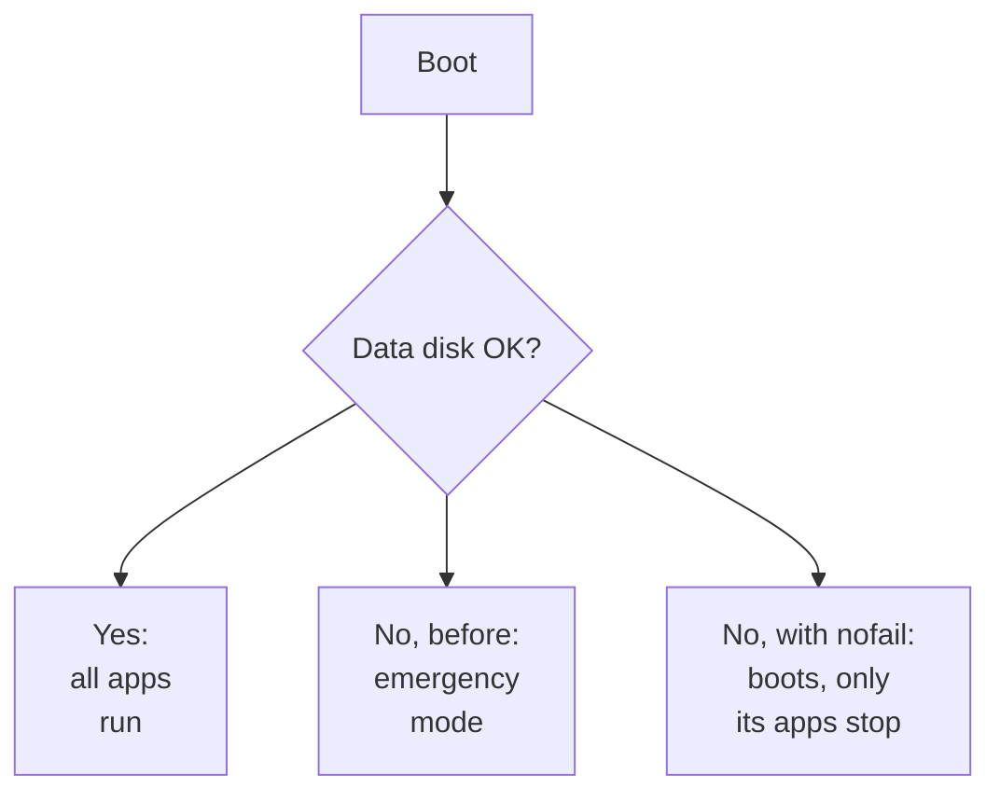

## 💥 What happened

On 2026-10-12 the 1 TB hard drive in my home server got corrupted. It held my movies, photos and the server's own backups. Worse, the server **stopped booting**:

*A recreated example of the screen: the same messages, without my disk's ID.*

## 🔧 Getting it to boot again

Linux was waiting for a disk listed in `/etc/fstab` (the list of disks to mount at boot) that would never answer. At the console:

1. `nano /etc/fstab`: put a `#` in front of the dead disk's line.
2. `systemctl reboot` (plain `reboot` isn't found in emergency mode).
3. In Proxmox, turn off the backup storage on the dead disk, so backups don't fill the small boot SSD.

The server came back. Apps on the boot SSD ran; apps that needed the big drive stayed down.

## 📦 What I lost

| What | Result | Why |
|---|---|---|
| Movies and series | ❌ Lost | Replaceable |
| Photos | ✅ Safe | Still on my phone |
| Server config | ✅ Safe | In a git repo |
| Passwords | ✅ Safe | Still running; I exported them right away |

None of that was a plan. **I had no second copy of anything**, and I got lucky.

## 🛠️ What I changed

- **New 1 TB SSD**, mounted with **`nofail`**: if it dies, the server still boots and only the apps that need it stop.

- **Encrypted off-site backups** every night of every database, the password manager and app settings, plus [a full restore test](restored-a-backup).
- **An outside check** that alerts me when the server stops checking in. My monitoring app runs on the same server, so it can't report its own death.
- **Cleanup I found along the way:** 2FA and a login page in front of the Proxmox admin page, full disks cleaned (78 % → 32 %), and pinned app versions instead of silent auto-updates.

## 🧠 Lessons

- A data disk in `/etc/fstab` needs **`nofail`**, or one dead disk stops the whole server.
- **One copy is no copy.** Backups, and a restore test, come before new data.
- **Monitoring on the same box can't tell you the box is down.**
- Disasters are a good audit. Half of my fixes that week had nothing to do with the drive.
