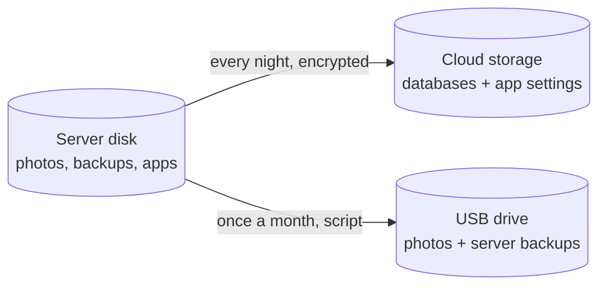

## 🕳️ The gap

My databases and app settings already go off-site every night, encrypted. But my photos (~54 GB) and the nightly backups of the whole server (~193 GB) lived on **one disk**. One dead disk would take the data *and* its backup. That breaks the **3-2-1 rule**: 3 copies, on 2 different media, 1 somewhere else.

Cloud storage for ~250 GB costs money every month. A 1 TB USB drive costs once.



## 💽 The drive

A plain portable hard drive, formatted **NTFS**. If the server is dead, I can plug it into *any* PC and see my photos. My private documents go on it **encrypted**; photos and server backups go as plain files.

## 🔁 The monthly script

Once a month I plug the drive in and run `usb-offsite.sh` as a background service, so a dropped SSH session doesn't stop it:

```bash
systemd-run --unit=usb-offsite /usr/local/bin/usb-offsite.sh
journalctl -fu usb-offsite
```

What it does:

1. Finds the drive **by its label** and mounts it. No guessing `/dev/sdX`.
2. Copies photos and backups with `rsync`, **without `--delete`**: a photo deleted by mistake on the server stays on the drive.
3. Keeps only the **newest** set of server backups, so 1 TB is enough.
4. **Checks itself:** a dry run must find nothing left to copy. Then it prints `OK … Safe to unplug.` or `CHECK FAILED`.
5. Unmounts the drive, also when something fails.

The first copy, about 84 GB, took 29 minutes.

## 🧠 Lessons

- "Off-site" starts with "off the server". A second disk in a drawer is already a big step up from zero.
- No `--delete` on a backup copy. Sync is not backup.
- A script that checks its own work beats me checking by eye every month.
- Pick the format for the day everything is broken: plain files on a drive any PC can read.
