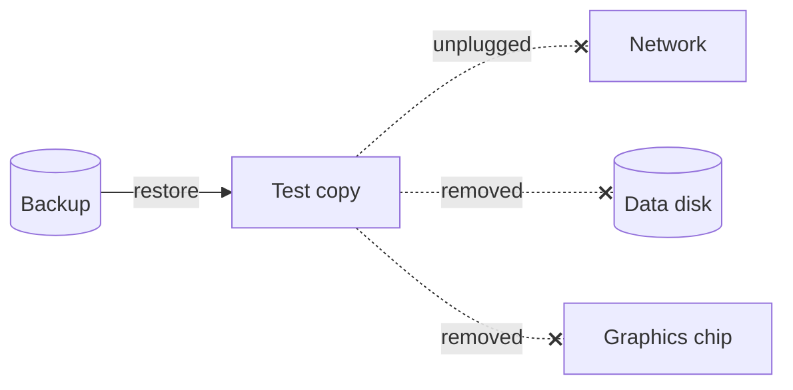

## 🤔 Why

> A backup only counts once you've restored from it.

Every night, Proxmox backs up every guest on my home server. The most important one is a single container that runs almost all my apps, including my password manager. The backups said `OK` every night, but I had never restored one. After [my hard drive died](my-hard-drive-died), I didn't want to find out on a bad day that "OK" meant nothing.

## ⚠️ The catch

A restored copy is a full clone. Started normally, it would read my email, send messages as if it were the real server, and write to the same data disk. So the copy had to start **cut off** from everything.



## 🛠️ What I did

On the Proxmox host (`$DUMP` is the backup folder, `$CT` the container's ID):

```bash
B=$(ls -1 "$DUMP"/vzdump-lxc-"$CT"-*.tar.zst | sort | tail -1)
pct restore 900 "$B" --storage local-lvm --unique 1 --start 0
pct set 900 --delete mp0,dev0 --onboot 0 --hostname restore-test
pct set 900 --net0 "…,link_down=1"
pct start 900
```

- The first line picks the newest backup file.
- `pct restore` builds a new container (ID 900) from it. `--unique 1` gives it a new network address, `--start 0` keeps it off for now.
- `--delete mp0,dev0` removes the shared data disk and the graphics chip, so the copy can't touch my real files.
- `link_down=1` is a virtual "cable unplugged": nothing gets in or out.

Then I compared **counts** between the real container and the copy: password items, expense rows, automations. Never the data itself.

## 📊 The result

- The backup restored in **6.5 minutes**, and every app came up within 3 more.
- The counts matched, except for what happened after the backup ran: one expense and one automation added that morning.
- The few apps that didn't start needed exactly what I had removed: the data disk, the graphics chip or the internet.

Then I deleted the copy: `pct stop 900 && pct destroy 900 --purge`.

**Verdict:** the backup works. Getting this container back takes about 10 minutes.

## 🧠 Lessons

- Test the restore, not only the backup job.
- Cut the copy off first. A clone of your server is still your server.
- A restore needs free disk space: my storage went from **53 % to 83 %** during the test.
- Counting things is enough to trust a restore, without opening any private data.
